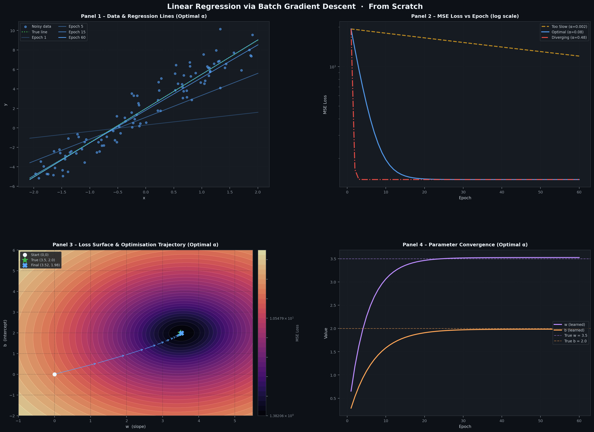

# Day 01 — Linear Regression via Batch Gradient Descent

> A complete from-scratch implementation and rich visual dashboard for understanding Batch Gradient Descent, built with only **NumPy** and **Matplotlib**.



---

## Overview

This project trains a simple linear regression model **from scratch** — no scikit-learn, no autograd — using Batch Gradient Descent. It runs three parallel learning-rate experiments and produces a 2×2 dark-themed Matplotlib dashboard that makes the internals of gradient descent visually intuitive.

---

## Quick Start

### Prerequisites

```bash
pip install numpy matplotlib
```

### Run

```bash
python day01_gradient_descent.py
```

This will:
1. Train three models (slow / optimal / diverging learning rates) for 60 epochs each
2. Render and **save** the 4-panel dashboard as `day01_gradient_descent_artifact.png`
3. Print a summary table to the terminal

---

## The Math

### Model
$$\hat{y} = w \cdot x + b$$

### Loss — Mean Squared Error
$$L = \frac{1}{N} \sum_{i=1}^{N} (\hat{y}_i - y_i)^2$$

### Gradients (analytical, closed-form)
$$\frac{\partial L}{\partial w} = \frac{2}{N} \sum_{i=1}^{N} (\hat{y}_i - y_i) \cdot x_i$$

$$\frac{\partial L}{\partial b} = \frac{2}{N} \sum_{i=1}^{N} (\hat{y}_i - y_i)$$

### Parameter Update Rule
$$w \leftarrow w - \alpha \cdot \frac{\partial L}{\partial w}, \qquad b \leftarrow b - \alpha \cdot \frac{\partial L}{\partial b}$$

---

## Synthetic Dataset

| Property | Value |
|---|---|
| True slope `w` | **3.5** |
| True intercept `b` | **2.0** |
| Noise | Gaussian, σ = 1.2 |
| Points `N` | 100 |
| Input range | x ∈ [−2, 2] |
| Random seed | 42 (reproducible) |

---

## Learning Rate Experiments

| Experiment | α (Learning Rate) | Behaviour |
|---|---|---|
| Too Slow | `0.002` | Converges, but far from optimum after 60 epochs |
| **Optimal** | **`0.08`** | Converges cleanly to near-true weights |
| Diverging | `0.48` | Parameters explode immediately (unstable) |

### Results after 60 epochs

| Learning Rate | Final w | Final b | Final MSE |
|---|---|---|---|
| Too Slow (α=0.002) | 2.5069 | 2.1397 | 12.4834 |
| **Optimal (α=0.08)** | **3.4474** | **2.0018** | **1.5150** |
| Diverging (α=0.48) | DIVERGED | DIVERGED | DIVERGED |
| **True values** | **3.5000** | **2.0000** | — |

---

## Dashboard Panels

| Panel | Description |
|---|---|
| **Panel 1** — Data & Regression Lines | Scatter plot of noisy data with the true line (green dotted) and the evolving fit line captured at epochs **1, 5, 15, 60** (fading opacity shows progression) |
| **Panel 2** — MSE Loss vs Epoch | Log-scale loss curves for all three learning rates, clearly showing slow convergence, fast convergence, and divergence |
| **Panel 3** — Loss Surface & Trajectory | 2D contour map of the `(w, b)` parameter space coloured by MSE loss (magma palette), with arrow annotations tracing the step-by-step optimisation path from `(0, 0)` to the minimum |
| **Panel 4** — Parameter Convergence | Learned `w` and `b` over epochs plotted against dashed reference lines at the true values `3.5` and `2.0` |

---

## Code Architecture

```
day01_gradient_descent.py
│
├── Section 0 – Global Matplotlib dark-theme aesthetics
├── Section 1 – Synthetic data generation
│
├── Section 2 – GradientDescentVisualizer class
│   ├── predict(x)           →  ŷ = wx + b
│   ├── mse_loss(y_hat)      →  (1/N) Σ (ŷ - y)²
│   ├── _grad_w(y_hat)       →  ∂L/∂w
│   ├── _grad_b(y_hat)       →  ∂L/∂b
│   ├── _update_params(...)  →  gradient step
│   └── fit()                →  full training loop + history
│
├── Section 3 – Run 3 experiments (slow / optimal / diverging)
├── Section 4 – Loss-surface grid computation
├── Section 5 – 2×2 dashboard rendering (4 panels)
├── Section 6 – Save PNG artifact
└── Section 7 – Terminal summary table
```

---

## Output Files

| File | Description |
|---|---|
| `day01_gradient_descent.py` | Single-file Python script (source) |
| `day01_gradient_descent_artifact.png` | High-resolution (180 DPI) dashboard image |

---

## Dependencies

| Package | Purpose |
|---|---|
| `numpy` | Data generation, matrix ops, gradient math |
| `matplotlib` | All plotting, contour maps, annotations |

> **No scikit-learn. No autograd. No deep-learning frameworks.**

---

## Key Concepts Demonstrated

- **Batch Gradient Descent** — every parameter update uses all N training samples
- **Learning rate sensitivity** — one of the most practically important hyperparameters
- **Loss surface geometry** — visualised as a convex bowl in (w, b) space
- **Analytical gradients** — derived and implemented by hand from the MSE definition
- **Parameter convergence** — how quickly learned parameters approach ground truth

---

## License

MIT — free to use, modify, and distribute.
